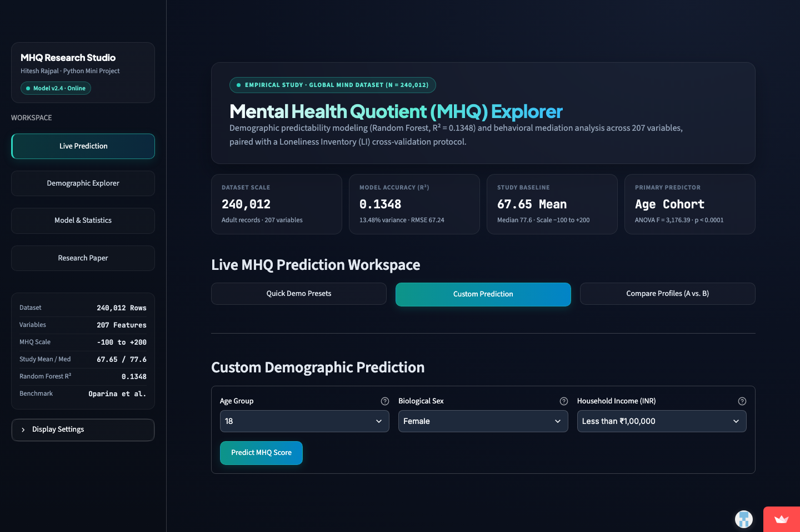
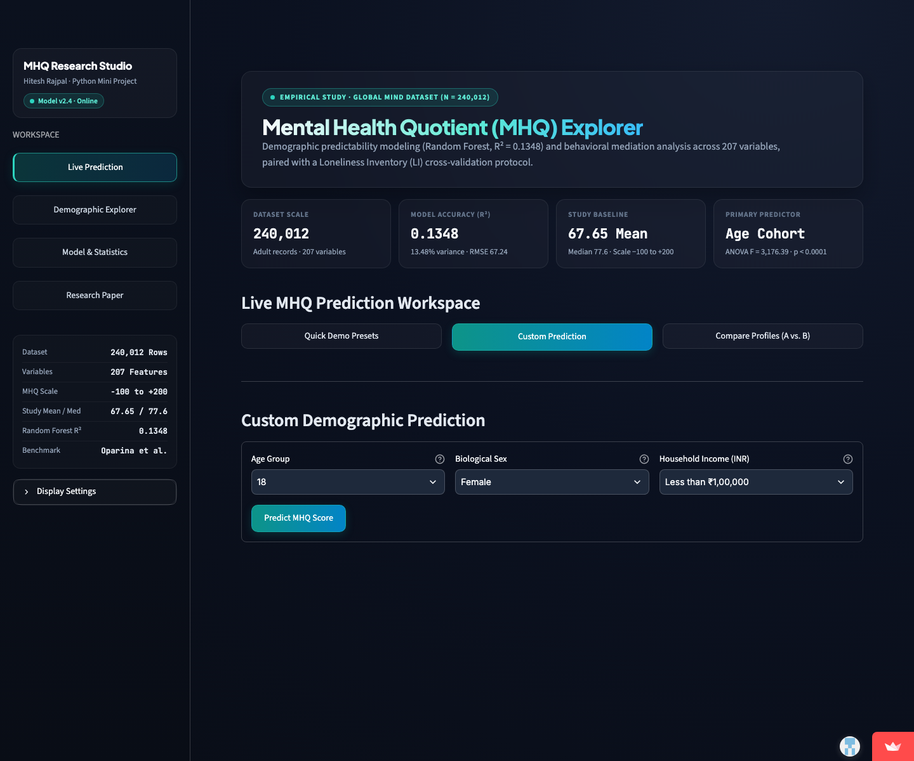
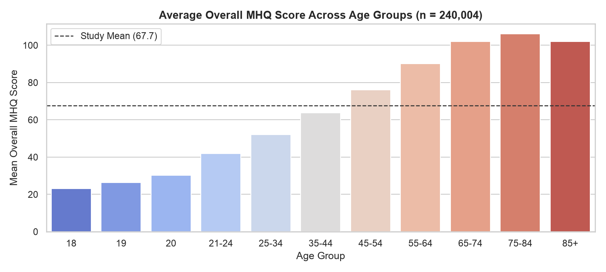
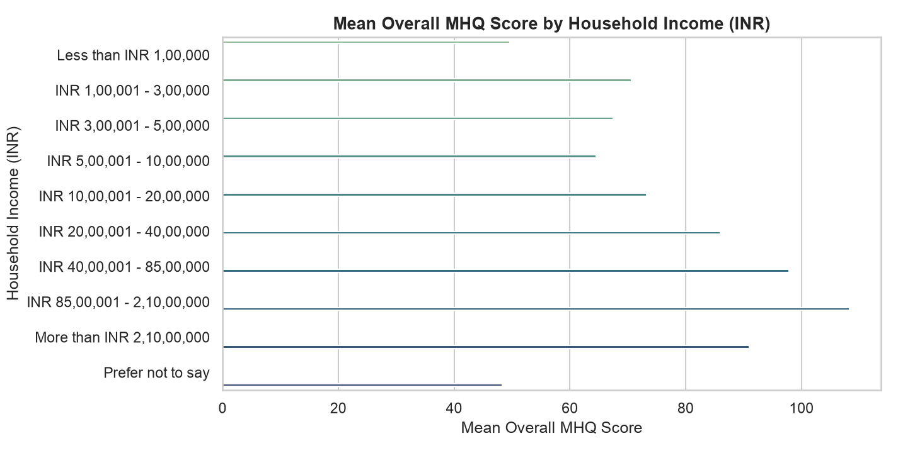
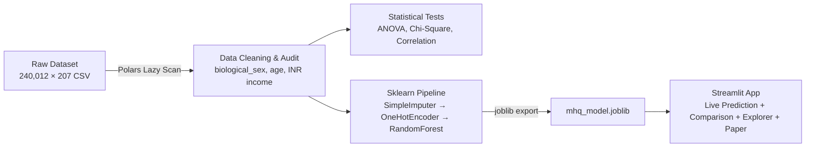

# 🧠 MHQ Research & Well-Being Dashboard

[](https://mhq-wellbeing-predictor.streamlit.app)
[](https://www.python.org/downloads/)
[](https://scikit-learn.org/)
[](LICENSE)

> ### 🌐 **Live Web Application:** [**mhq-wellbeing-predictor.streamlit.app**](https://mhq-wellbeing-predictor.streamlit.app)
> *Open the deployed interactive dashboard to test live well-being predictions, compare demographic profiles, explore population trends, and read the built-in research paper.*

An end-to-end data science and machine learning project analyzing **240,012 Mental Health Questionnaire (MHQ)** responses across **207 variables** to predict mental well-being (`overall_mhq_score`) and domain sub-scores from demographic features (`age`, `biological_sex`, `income_household` normalized in INR), complete with statistical hypothesis testing, an interactive research paper, and a deployed **Streamlit** web application.

---

## 🖥️ Live Web Application & Dashboard Interface

Experience the deployed web application live at **[mhq-wellbeing-predictor.streamlit.app](https://mhq-wellbeing-predictor.streamlit.app)**.

### 1. Main Well-Being Predictor & Population Gauge
Real-time demographic inference with interactive presets (Young Adult, Mid-Career, Older Adult), a semicircular MHQ gauge, and population percentile positioning.



### 2. Multi-Profile Comparison & Analytics Explorer
Side-by-side Profile A vs. Profile B comparison, life course progression charts, and INR-normalized demographic distribution explorers.



---

## ✨ Dashboard Highlights

- **🎯 Live Prediction & One-Click Demo Presets:** Instantly test Young Adult, Mid-Career, and Older Adult profiles with a semicircular MHQ gauge, well-being tier card, and study percentile.
- **⚖️ Profile A vs. Profile B Comparison:** Compare two demographic profiles side-by-side to see exact predicted MHQ score differences.
- **📊 Demographic Explorer:** Filter distributions by age and biological sex, explore all 5 MHQ dimensions across age groups, and inspect INR-normalized income trends.
- **📄 Built-In Research Paper:** Read the plain-English overview, glossary, and 6 embedded figures directly in the app or download `research_paper.html`.

---

## 📊 Key Findings & Visual Highlights

### 1. Age Is the Dominant Predictor of Mental Well-Being
One-Way ANOVA and Random Forest feature importance both confirm a strong, statistically significant relationship between age group and overall MHQ score ($F = 3176.39, p < 0.0001$), with older cohorts (`55-64`, `65-74`) scoring substantially higher on average than young adults (`18–24`).



### 2. Household Income Trends (Standardized in INR)
All mixed currency brackets were standardized into 10 Indian Rupee (INR) brackets for clear regional comparison.



### 3. Top Demographic Predictors (Random Forest)


### 4. Predictability Across MHQ Targets


| Target Variable | R² Score | RMSE | Interpretation |
| :--- | :---: | :---: | :--- |
| **`cognition_score`** | **0.1356** | 63.40 | Most predictable sub-score |
| **`overall_mhq_score`** | **0.1348** | 67.24 | Primary well-being outcome |
| **`adapt_resilience_score`** | **0.1281** | 61.59 | Resilience & adaptability |
| **`drive_motivation_score`** | **0.1137** | 63.69 | Drive & motivation |
| **`social_self_score`** | **0.1013** | 72.52 | Least predictable from demographics |

---

## 🧪 Statistical Hypothesis Testing

| Test | Variables | Statistic | p-value | Conclusion |
| :--- | :--- | :---: | :---: | :--- |
| **One-Way ANOVA** | `age` → `overall_mhq_score` | $F = 3176.39$ | $< 0.0001$ | Reject $H_0$ (Significant) |
| **One-Way ANOVA** | `biological_sex` → `overall_mhq_score` | $F = 586.09$ | $< 0.0001$ | Reject $H_0$ (Significant) |
| **One-Way ANOVA** | `income_household` → `overall_mhq_score` | $F = 66.07$ | $8.72 \times 10^{-259}$ | Reject $H_0$ (Significant) |
| **Chi-Square** | `biological_sex` × `income_household` | $\chi^2 = 1666.66$ | $7.26 \times 10^{-309}$ | Dependent ($n = 19,520$) |

> **Data Quality Discovery:** The raw `gender` column contained 100% missing values (`240,012 / 240,012` nulls), which caused Chi-Square and preprocessing errors. Switching to `biological_sex` (`239,995` valid entries) resolved all warnings and enabled full pipeline execution.

---

## 🔄 End-to-End Architecture



---

## 🚀 Quickstart

```bash
# Clone the repository
git clone https://github.com/hiteshrajpal108-stack/Mini-Project.git
cd Mini-Project

# Install dependencies & run app
pip install -r requirements.txt
streamlit run app.py
```

Or access the hosted application directly without setup: **[mhq-wellbeing-predictor.streamlit.app](https://mhq-wellbeing-predictor.streamlit.app)**

---

## 📁 Repository Structure

```text
├── app.py                        # Interactive Streamlit dashboard (Presets, Comparison, Explorer, Paper)
├── model_pipeline.py             # Standalone Python script for data processing & ML pipeline
├── PythonProjectNew.ipynb        # Analysis & training notebook
├── Research_Paper_Interactive.html # Interactive research paper markup with 6 figures & glossary
├── paper_style.css               # Dedicated stylesheet for research paper UI & typography
├── paper_script.js               # Interactive JavaScript (live search, TOC tracking, lightbox)
├── mhq_model.joblib              # Pre-trained Random Forest Pipeline
├── demographic_summary.csv       # Pre-aggregated age & biological sex statistics
├── mhq_bins.csv                  # Pre-binned histogram counts for fast cloud charts
├── income_summary.csv            # INR-normalized household income statistics
├── Full_Statistics.csv           # Exported numeric summary statistics
├── Presentation_Summary.md       # Concise presentation & findings brief
├── Viva_Cheat_Sheet.md           # 1-page oral defense reference guide
├── AI_Insights_Report.md         # Automated data exploration notes
├── requirements.txt              # Python dependencies
├── .gitattributes                # Repository language detection configuration
├── .streamlit/config.toml        # Custom Streamlit dark-glass UI theme
├── assets/                       # UI screenshots and publication figures
│   ├── dashboard_preview.png     # Live Streamlit front web page screenshot
│   ├── dashboard_features.png    # Live Streamlit comparison & explorer screenshot
│   ├── feature_importance.png    # Top 10 Random Forest predictors
│   ├── mhq_by_age_distribution.png
│   ├── mhq_by_income_inr.png
│   ├── subscore_predictability.png
│   ├── subscore_by_age_and_sex.png
│   ├── mhq_direct_indirect_relations.png
│   └── pipeline_architecture.png
└── LICENSE                       # MIT License
```
