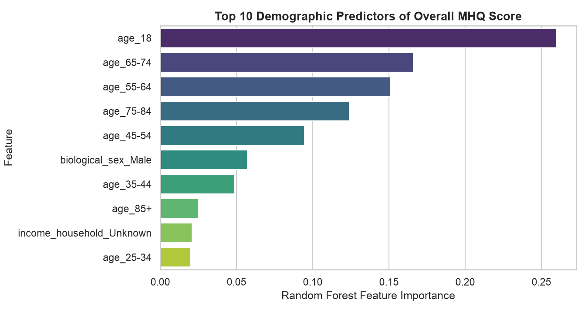
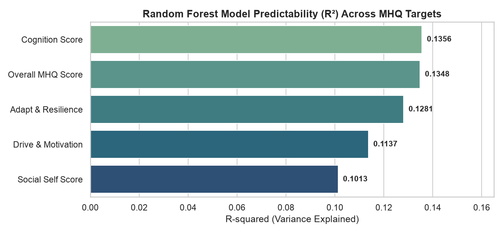
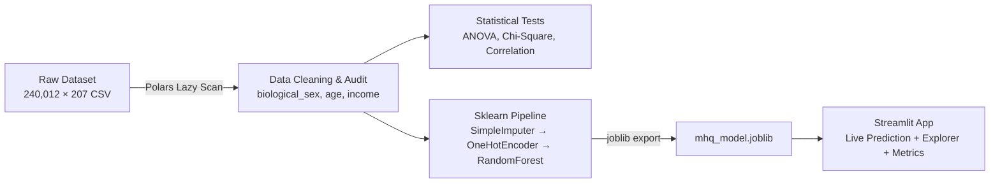

# 🧠 MHQ Mental Well-Being Prediction & Interactive Dashboard

**Python 3.13** · **Streamlit** · **Scikit-Learn (Random Forest)** · **Polars (240,012 Rows)** · **MIT License**

An end-to-end data science and machine learning project analyzing **240,012 Mental Health Questionnaire (MHQ)** responses across **207 variables** to predict mental well-being (`overall_mhq_score`) and domain sub-scores from demographic features (`age`, `biological_sex`, `income_household`), complete with statistical hypothesis testing and a ready-to-deploy **Streamlit** web application.

---

## 📊 Key Findings & Visual Highlights

### 1. Age Is the Dominant Predictor of Mental Well-Being
One-Way ANOVA and Random Forest feature importance both confirm a strong, statistically significant relationship between age group and overall MHQ score ($F = 3176.39, p < 0.0001$), with older cohorts (`55-64`, `65-74`) scoring substantially higher on average than young adults (`18–24`).


### 2. Top Demographic Predictors (Random Forest)


### 3. Predictability Across MHQ Targets


| Target Variable | R² Score | RMSE | Interpretation |
| :--- | :---: | :---: | :--- |
| **`cognition_score`** | **0.1356** | 63.40 | Most predictable sub-score |
| **`overall_mhq_score`** | **0.1348** | 67.24 | Primary well-being outcome |
| **`adapt_resilience_score`** | **0.1281** | 61.59 | Resilience & adaptability |
| **`drive_motivation_score`** | **0.1137** | 63.69 | Drive & motivation |
| **`social_self_score`** | **0.1013** | 72.52 | Least predictable from demographics |

---

## 🧪 Statistical Hypothesis Testing

| Test | Variables | Statistic | p-value | Conclusion |
| :--- | :--- | :---: | :---: | :--- |
| **One-Way ANOVA** | `age` → `overall_mhq_score` | $F = 3176.39$ | $< 0.0001$ | Reject $H_0$ (Significant) |
| **One-Way ANOVA** | `biological_sex` → `overall_mhq_score` | $F = 586.09$ | $< 0.0001$ | Reject $H_0$ (Significant) |
| **One-Way ANOVA** | `income_household` → `overall_mhq_score` | $F = 66.07$ | $8.72 \times 10^{-259}$ | Reject $H_0$ (Significant) |
| **Chi-Square** | `biological_sex` × `income_household` | $\chi^2 = 1666.66$ | $7.26 \times 10^{-309}$ | Dependent ($n = 19,520$) |

> **Data Quality Discovery:** The raw `gender` column contained 100% missing values (`240,012 / 240,012` nulls), which caused Chi-Square and preprocessing errors. Switching to `biological_sex` (`239,995` valid entries) resolved all warnings and enabled full pipeline execution.

---

## 🔄 End-to-End Architecture



---

## 🚀 Quickstart & Deployment

### Run Locally
```bash
pip install -r requirements.txt
streamlit run app.py
```

### Deploy on Streamlit Community Cloud
1. Push this repository to GitHub (`hiteshrajpal108-stack`).
2. Open Streamlit Community Cloud (`share.streamlit.io`), select your repository, branch `main`, and main file `app.py`.
3. Click **Deploy** — `app.py` loads `mhq_model.joblib` directly for instant live predictions without requiring the 362 MB raw CSV.

---

## 📁 Repository Structure

```text
├── app.py                     # Interactive Streamlit dashboard (Live Prediction, Explorer, Model Metrics)
├── PythonProjectNew.ipynb     # Complete error-free analysis & training notebook
├── mhq_model.joblib           # Pre-trained Random Forest Pipeline
├── Full_Statistics.csv        # Exported numeric summary statistics
├── Presentation_Summary.md    # Concise presentation & findings brief
├── AI_Insights_Report.md      # Automated data exploration notes
├── requirements.txt           # Python dependencies
├── .streamlit/config.toml     # Custom Streamlit UI theme
├── assets/                    # Publication-ready charts embedded in README
└── LICENSE                    # MIT License
```
